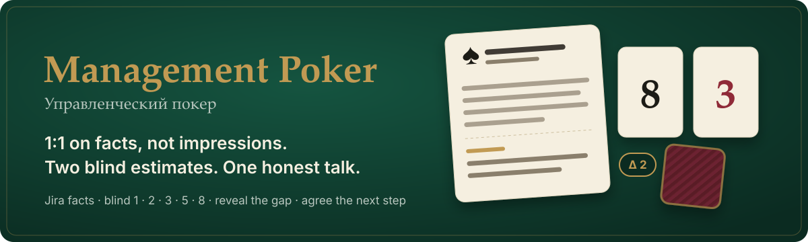
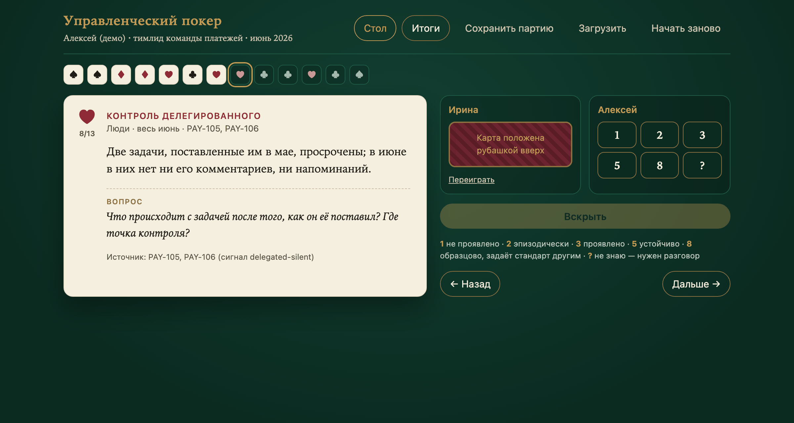
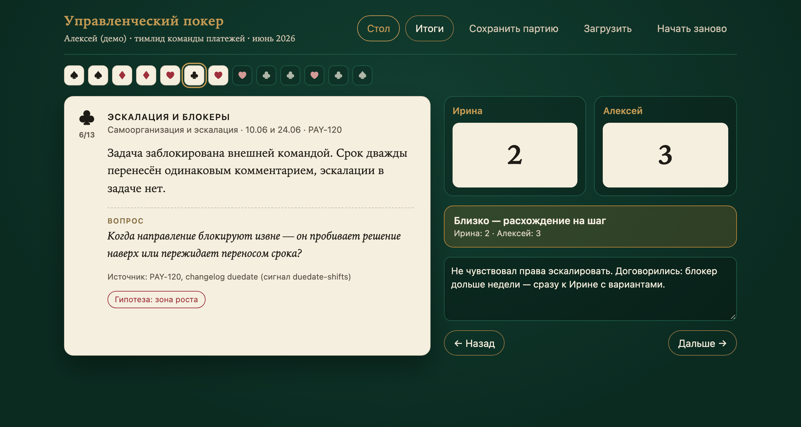
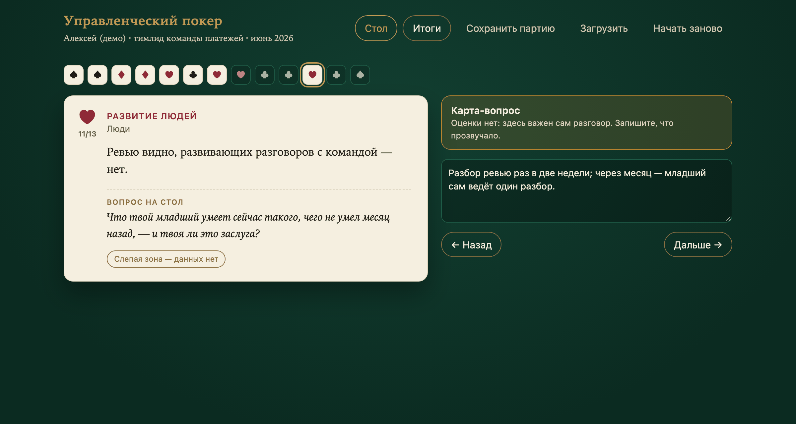
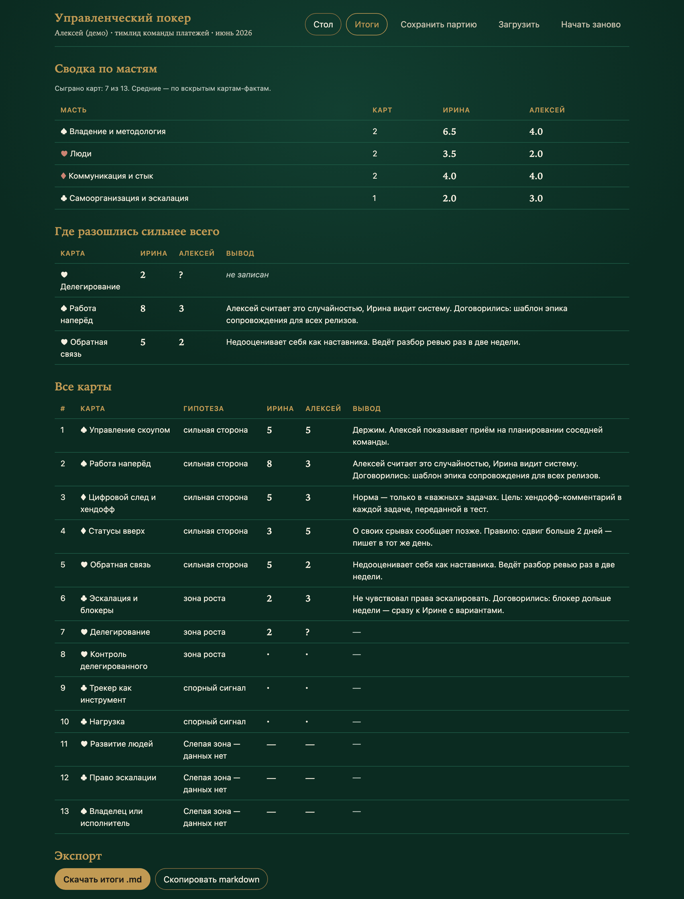
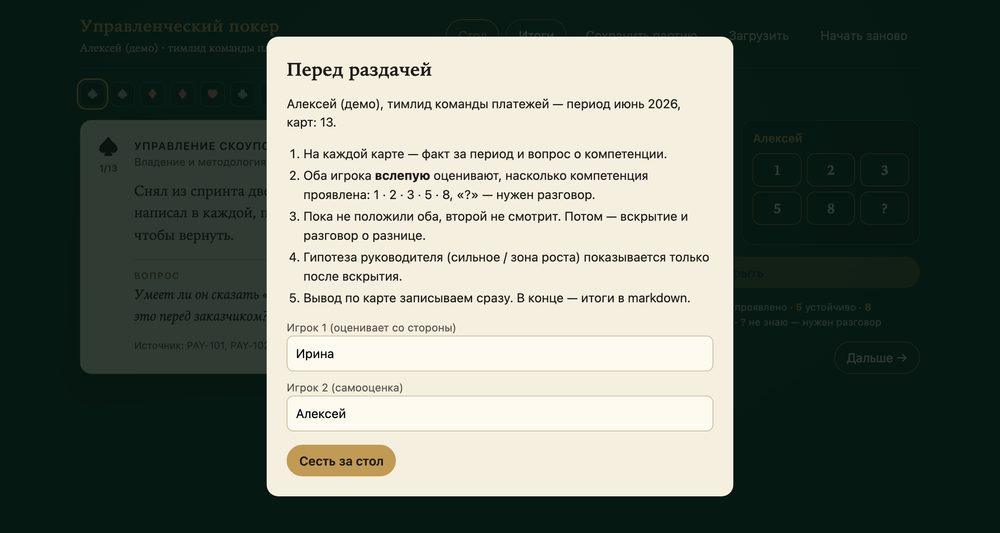
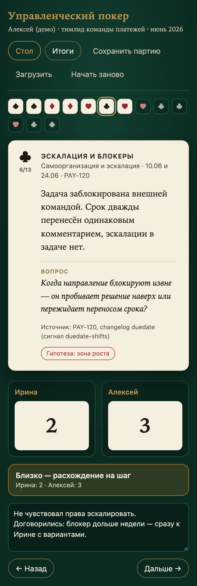

<div align="center">



<br>

[](https://github.com/Artibaldi/mgmt-poker/actions/workflows/ci.yml)
[](LICENSE)
[](poker/)
[](docs/jira-integration.md)
[](poker/template/game.html)
[](#status-and-honest-limits)

**English** · [Русский](README.ru.md) · [Docs](docs/README.md) · [Roadmap](ROADMAP.md) · [Changelog](CHANGELOG.md)

[**See it**](#see-it) ·
[**Quick start**](#quick-start) ·
[**Rules**](#rules) ·
[**How it works**](#how-it-works) ·
[**Honest limits**](#status-and-honest-limits)

</div>

<br>

**Management Poker** (*Управленческий покер*) is a format for a manager's 1:1 with a team member, built on
facts instead of impressions. Episodes from the period — pulled from Jira and meeting notes — go on cards.
Both players estimate each card **blind**, reveal, and talk about the **gap**. The gap is the agenda.

The tool prepares the deck from Jira and runs the session as a single offline HTML file.

> [!NOTE]
> The interface and the method docs are in Russian. This README is the English entry point;
> [README.ru.md](README.ru.md) is the full Russian version.

## Why

Performance conversations usually fail in the same few places:

| In a typical 1:1… | …Management Poker's answer |
|---|---|
| 💭 **“Feels like you're not escalating enough.”** | Every card is a concrete episode with a source you can open at the table: an issue key, a comment, a meeting note. |
| 🪞 **The self-review drifts toward the manager's opinion.** | Estimates are blind. The manager's hypothesis (strength / growth area) is shown only **after** the reveal. |
| 📊 **Metrics turn into a ranking.** | Jira signals are hypotheses for the manager to check, not scores. There is no comparison between people. |
| 🗣️ **The talk spreads over everything.** | Where you agree, you move on. Where you differ by two steps or more, you stop and talk. |
| 📝 **Agreements evaporate.** | Each card gets a one-line outcome; the summary exports to Markdown. |

## See it

| Blind estimate | Reveal and the gap |
|---|---|
|  |  |
| **Question card — a blind spot** | **Summary** |
|  |  |

<details>
<summary>Setup and mobile</summary>

 

</details>

All screenshots use the fictional deck from [`examples/demo-cards.json`](examples/demo-cards.json).

## What you get

<table>
<tr>
<td width="33%" valign="top">

#### 🔌 Read-only Jira context

One person, one period: their issues, their own comments, transitions, field edits and worklogs.
Rate-limit friendly; nothing is ever written back.

</td>
<td width="33%" valign="top">

#### 🔎 Signals, not scores

Repeated due-date shifts, a workflow run through in minutes, late-night activity, silent delegated
tasks — each with issue keys and a question to check.

</td>
<td width="33%" valign="top">

#### 🃏 A deck with a schema

10–14 fact cards plus 2–4 question cards, four suits for four competence clusters. Prompts turn a
dossier into a deck; a validator checks it.

</td>
</tr>
<tr>
<td valign="top">

#### 🙈 Blind estimates

1 · 2 · 3 · 5 · 8 · ?, face down until both have played. Then the reveal and the gap in steps.

</td>
<td valign="top">

#### 📴 One offline file

The game is a single HTML file: no server, no network, no install. State lives in the browser and can
be saved to and loaded from a JSON file.

</td>
<td valign="top">

#### 🔒 People's data stays local

Everything about real people lives in `sessions/`, which is git-ignored. The repository holds only the tool,
the method and a fictional example.

</td>
</tr>
</table>

## Quick start

Try the game without Jira (Python 3.9+, no dependencies):

```bash
git clone https://github.com/Artibaldi/mgmt-poker.git
cd mgmt-poker
python3 -m poker.build examples/demo-cards.json --out /tmp/demo.html
open /tmp/demo.html          # or xdg-open on Linux
```

Prepare a real session:

```bash
cp .env.example .env                              # JIRA_URL, JIRA_PROJECT_KEY, credentials
cp config/jira.example.json config/jira.json      # your custom field ids

uv run --with requests python -m poker.fetch --login jdoe --from 2026-06-01 --to 2026-06-30 --roles
python3 -m poker.signals sessions/jdoe_2026-06/activity.json
# dossier.md and cards.json — from prompts/ (in Claude Code: /poker jdoe 2026-06)
python3 -m poker.build sessions/jdoe_2026-06/cards.json
open sessions/jdoe_2026-06/game.html
```

| Script | What it does |
|---|---|
| `scripts/test.sh` | Every check: unit tests, demo build, JS syntax of the template, no tracked session data |

<details>
<summary>Configuration</summary>

| Where | What |
|---|---|
| `.env` or `POKER_ENV=/path/.env` | `JIRA_URL`, `JIRA_PROJECT_KEY`, `JIRA_USERNAME`, `JIRA_PASSWORD`; optional `POKER_DAILY_DIR` |
| `config/jira.json` | `epic_field`, `role_fields`, `scriptrunner_commented`, `verify_ssl`, `pause_seconds`, `workday` |

</details>

## Rules

<details>
<summary><b>The deck</b></summary>

- **Fact card:** an episode from the period (when, where, what was done) + a question about the competence +
  a source you can open.
- **Question card:** a blind spot with no digital trace — a question for the table, no estimate.
- **Suits are competence clusters:** ♠ ownership and method · ♥ people · ♦ communication and interfaces ·
  ♣ self-management and escalation.
- **Manager's hypothesis** per card: strength, growth area, disputed signal or blind spot. Hidden until the reveal.
- At least as many strengths as growth areas. Facts are written without judgement words.

</details>

<details>
<summary><b>Estimates and the gap</b></summary>

```
1  not shown        2  occasionally        3  shown
5  consistently     8  exemplary, sets the standard for others
?  don't know — needs a conversation
```

- The scale is non-linear on purpose, like planning poker: 5 → 8 is a qualitative jump.
- The gap is counted in **steps** of the scale: 0 — agreed, 1 — close, ≥ 2 or “?” — stop and talk.
- The person who estimated higher speaks first. The goal is to understand, not to convince.

</details>

<details>
<summary><b>The session</b></summary>

1. **Frame (5 min):** why we meet; this is not an appraisal; the results stay between the two of us.
2. **Deal:** read the fact → both play face down → reveal.
3. **Talk about the gap**, then write one line: what we do and by when, or “keep as is”.
4. **Question cards** at the end, when the conversation is warm.
5. **Summary:** averages by suit, the largest gaps, all agreements → Markdown. Next month — a new deck.

Full method: [docs/method.md](docs/method.md) (Russian).

</details>

<details>
<summary><b>Jira signals</b></summary>

| Signal | Rule | Suit · competence |
|---|---|---|
| `all-on-self` | assignee on ≥ 60 % of issues, delegates to ≤ 1 person | ♥ Delegation |
| `delegated-silent` | a delegated issue is overdue, no comment or transition from the person | ♥ Follow-up on delegated work |
| `duedate-shifts` | the person moved the due date ≥ 2 times | ♣ Escalation and blockers |
| `overdue` | own issue overdue at the end of the period | ♣ Deadlines |
| `tracker-post-factum` | ≥ 4 own transitions within 60 minutes | ♣ Tracker as a tool |
| `off-hours` | ≥ 3 actions outside working hours or on weekends | ♣ Workload |
| `self-set` | the person put themselves into role fields | ♠ Process ownership |
| `handoff` / `silent-tracker` | comments with @-mentions / no comments at all | ♦ Digital trail and handoff |

Every signal is a hypothesis with issue keys. What Jira cannot show — growing people, verbal escalations,
chat work — goes into question cards. Details: [docs/jira-integration.md](docs/jira-integration.md) (Russian).

</details>

## How it works

```
poker/
  fetch.py               Jira (read-only, REST v2) → sessions/<login>_<YYYY-MM>/activity.json
  signals.py             activity.json → signals.md / signals.json (hypotheses with issue keys)
  build.py               cards.json + template → game.html (validation, safe embedding)
  template/game.html     the game: one file, vanilla JS, no network
  config.py              .env, field mapping, session folder
prompts/                 dossier.md and cards.md — prompts for Claude
schema/                  cards.schema.json — the deck contract
examples/                a fictional deck for demos and tests
.claude/skills/poker/    the /poker skill for Claude Code
sessions/                git-ignored: everything about real people
```

```
Jira ──fetch──▶ activity.json ──signals──▶ signals.md ─┐
                                                        ├─▶ dossier.md ──▶ cards.json ──build──▶ game.html
meeting notes (POKER_DAILY_DIR) ────────────────────────┘
```

- **Read-only.** `fetch` only issues `GET` requests, pauses between calls and backs off on 429.
- **Filtered by author after the fact.** Jira Server cannot filter comments or transitions by author in JQL,
  so the tool takes the pool of issues the person touches and filters each history locally.
- **The game is static.** Data is embedded at build time (with `</script>` escaped); state is kept in
  `localStorage` per deck and can be exported to JSON.

## Testing

```bash
scripts/test.sh
```

- **`tests/test_signals.py`** — each signal fires on a crafted activity and stays quiet on a calm month.
- **`tests/test_build.py`** — deck validation, embedding, protection against breaking out of `<script>`.
- **Template** — JS syntax check with Node.
- **Hygiene** — the check fails if anything under `sessions/` except `.gitkeep` is tracked.

CI runs the same checks on Python 3.9 and 3.12 on every push and pull request ([`ci.yml`](.github/workflows/ci.yml)).

## Status and honest limits

Management Poker is an **MVP**. What it does not do yet:

- Jira Cloud is not supported: user `name` is hidden there, filtering needs `accountId`.
- The dossier and the deck are written with Claude from prompts; there is no non-LLM generator.
- A session is played on one screen; there is no two-device mode with truly separate hands.
- The interface is Russian only.

What's next is in the [roadmap](ROADMAP.md).

## Contributing, security, license

- How to run, test and send a change: [CONTRIBUTING.md](CONTRIBUTING.md).
- Security and privacy issues go through [SECURITY.md](SECURITY.md), not public issues.
- Licensed under [Apache-2.0](LICENSE). © 2026 Arti.
