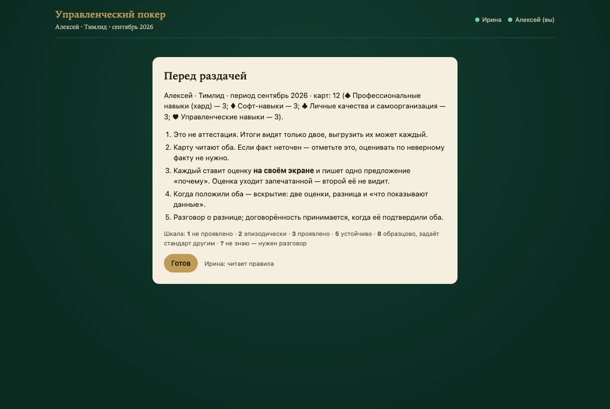
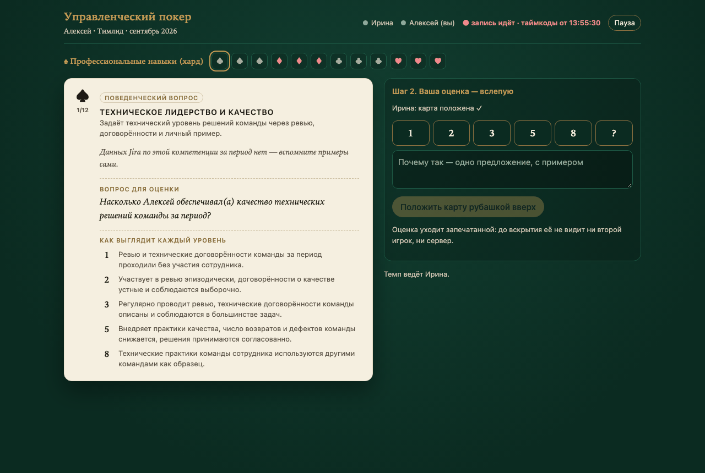
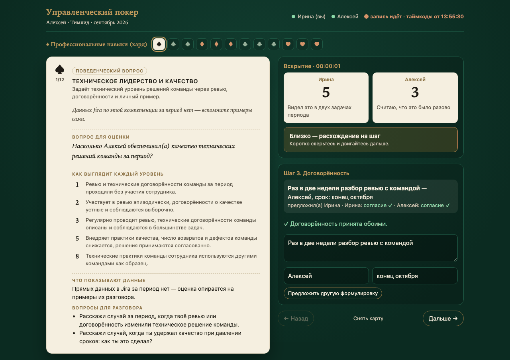
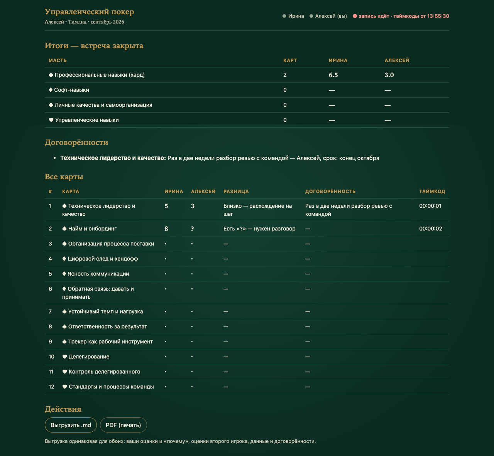

<div align="center">


<br>

[](https://github.com/Artibaldi/mgmt-poker/actions/workflows/ci.yml)
[](LICENSE)
[](poker/)
[](docs/jira-integration.md)
[](poker/template/game.html)
[](#ограничения-и-планы)

[English](README.md) · **Русский** · [Документация](docs/README.md) · [Планы](ROADMAP.md) · [Изменения](CHANGELOG.md)

[**Скриншоты**](#скриншоты) ·
[**Быстрый старт**](#быстрый-старт) ·
[**Онлайн-встреча**](docs/spec-online.md) ·
[**Правила**](#правила) ·
[**Архитектура**](#архитектура) ·
[**Ограничения**](#ограничения-и-планы)

</div>

<br>

**Управленческий покер** — формат 1:1 руководителя с сотрудником на фактах, а не на впечатлениях. Эпизоды за
период — из Jira и саммари встреч — ложатся на карты. Оба игрока оценивают каждую карту **вслепую**,
вскрывают оценки и говорят о **разнице**. Разница и есть повестка встречи.

**Онлайн-режим:** руководитель задаёт только человека и период. Колода собирается автоматически по модели
компетенций роли — хард по должности, софт, личные качества, управленческие — и **запечатывается**: карт
до встречи не видит никто. На ВКС под запись каждый оценивает на своём экране; оценка уходит печатью (хешем),
поэтому никто не видит оценку визави, пока не положили оба. После встречи сотрудник выгружает ответы обеих сторон.

Офлайн-режим на одном экране (один HTML-файл) остаётся для очных встреч.

---

## Идея

1. Выгружаем из Jira действия человека за период: его задачи, комментарии, переходы, правки, ворклоги.
2. Автоматика подсвечивает **сигналы** — где смотреть: переносы сроков, «прощёлканный» workflow, ночная работа.
3. Руководитель проверяет сигналы руками, добавляет встречи и собирает **досье** и **колоду**.
4. За столом оба кладут оценку рубашкой вверх: `1 · 2 · 3 · 5 · 8 · ?`.
5. Вскрытие: сошлись — дальше; разошлись на два шага и больше — разговор и договорённость.
6. Итоги по мастям и все договорённости — в markdown. Через месяц — новая колода.

## Зачем

| Как обычно идёт 1:1… | …и что делает покер |
|---|---|
| 💭 **«Кажется, ты мало эскалируешь».** | Каждая карта — конкретный эпизод с источником, который можно открыть за столом. |
| 🪞 **Самооценка подстраивается под руководителя.** | Оценки слепые — запечатаны, пока не положили оба. «Что показывают данные» видно только **после** вскрытия. Карт до встречи не видит никто, включая руководителя. |
| 📊 **Метрики превращаются в рейтинг.** | Сигналы Jira — гипотезы для проверки, а не баллы. Сравнения людей нет. |
| 🗣️ **Разговор расползается.** | Где сошлись — идём дальше. Где разрыв — останавливаемся. |
| 📝 **Договорённости теряются.** | У каждой карты — одна строка вывода; итоги выгружаются в markdown. |

## Скриншоты

**Онлайн-комната** — каждый на своём экране во время ВКС под запись:

| Перед раздачей: колода открывается у обоих одновременно | Слепая оценка: второй видит только «карта положена ✓» |
|---|---|
|  |  |
| **Вскрытие, «почему», данные и договорённость, подтверждённая обоими** | **Итоги — сотрудник выгружает ответы обеих сторон** |
|  |  |

**Офлайн-игра на одном экране:**

| Слепая оценка | Вскрытие и разница |
|---|---|
|  |  |
| **Карта-вопрос — слепая зона** | **Итоги** |
|  |  |

<details>
<summary>Перед раздачей и на телефоне</summary>

 

</details>

На всех скриншотах — вымышленная колода из [`examples/demo-cards.json`](examples/demo-cards.json).

## Что внутри

<table>
<tr>
<td width="33%" valign="top">

#### 🔐 Запечатанная колода

Собирается автоматически из Jira и профиля роли. Ключ разделён между двумя ссылками — карты открываются,
только когда в комнате оба.

</td>
<td width="33%" valign="top">

#### 🖥️🖥️ Два экрана, один стол

Маленький ретранслятор на stdlib на ноутбуке руководителя, доступный по VPN. Commit–reveal держит оценки
слепыми даже от самого ретранслятора.

</td>
<td width="33%" valign="top">

#### 🧭 8 профилей ролей

Системный и бизнес-аналитик, разработчик, тестировщик, DevOps, архитектор, РП, тимлид — с поведенческими
якорями на каждый уровень.

</td>
</tr>
<tr>
<td width="33%" valign="top">

#### 🔌 Контекст из Jira, только чтение

Один человек, один период: его задачи и только его комментарии, переходы, правки полей и ворклоги.
Паузы против rate-limit; в Jira ничего не пишется.

</td>
<td width="33%" valign="top">

#### 🔎 Сигналы, а не баллы

Повторные переносы срока, workflow за минуты, ночная активность, молчание по делегированному — каждый
сигнал с ключами задач и вопросом для проверки.

</td>
<td width="33%" valign="top">

#### 🃏 Колода по схеме

10–14 карт-фактов и 2–4 карты-вопроса, четыре масти — четыре кластера компетенций. Промпты превращают
досье в колоду, валидатор её проверяет.

</td>
</tr>
<tr>
<td valign="top">

#### 🙈 Слепая оценка

1 · 2 · 3 · 5 · 8 · ?, рубашкой вверх, пока не положили оба. Потом вскрытие и разница в шагах шкалы.

</td>
<td valign="top">

#### 📴 Один офлайн-файл

Игра — один HTML-файл: без сервера, сети и установки. Партия хранится в браузере и сохраняется в json.

</td>
<td valign="top">

#### 🔒 Данные о людях — только локально

Всё о реальных людях лежит в `sessions/` под `.gitignore`. В репозитории — инструмент, метод и
вымышленный пример.

</td>
</tr>
</table>

## Быстрый старт

### Онлайн-комната без Jira (Python 3.9+, без зависимостей)

```bash
git clone https://github.com/Artibaldi/mgmt-poker.git && cd mgmt-poker
python3 -m poker.relay &                                   # комната на :8765
python3 -m poker.new --login demo --from 2026-09-01 --to 2026-09-30 \
  --role team-lead --name Алексей --activity examples/demo-activity.json --relay http://localhost:8765
# откройте две напечатанные ссылки в двух разных браузерах (например, в обычном и приватном окне)
```

Настоящая встреча — Jira, VPN, реестр команды, Claude — по шагам: [docs/deploy-local.md](docs/deploy-local.md).
Путь, протокол и модель доверия — [docs/spec-online.md](docs/spec-online.md); модель компетенций —
[docs/competencies.md](docs/competencies.md); подключение Claude — [docs/llm.md](docs/llm.md).

### Офлайн-игра на одном экране

Посмотреть игру без Jira (Python 3.9+, без зависимостей):

```bash
git clone https://github.com/Artibaldi/mgmt-poker.git
cd mgmt-poker
python3 -m poker.build examples/demo-cards.json --out /tmp/demo.html
open /tmp/demo.html
```

Собрать офлайн-колоду вручную:

```bash
cp .env.example .env                              # JIRA_URL, JIRA_PROJECT_KEY, креды
cp config/jira.example.json config/jira.json      # id кастомных полей вашей Jira

uv run --with requests python -m poker.fetch --login jdoe --from 2026-06-01 --to 2026-06-30 --roles
python3 -m poker.signals sessions/jdoe_2026-06/activity.json
# dossier.md и cards.json — по prompts/ (в Claude Code: /poker jdoe 2026-06)
python3 -m poker.build sessions/jdoe_2026-06/cards.json
open sessions/jdoe_2026-06/game.html
```

| Скрипт | Что делает |
|---|---|
| `python3 -m poker.relay` | Комната для онлайн-встреч ([deploy-local.md](docs/deploy-local.md)) |
| `python -m poker.new` | Создать встречу: человек + период → запечатанная колода + две ссылки |
| `scripts/test.sh` | Все проверки: тесты Python и Node, сборка демо, синтаксис JS, отсутствие данных сессий в git |

<details>
<summary>Настройки</summary>

| Где | Что |
|---|---|
| `.env` или `POKER_ENV=/путь/.env` | `JIRA_URL`, `JIRA_PROJECT_KEY`, `JIRA_USERNAME`, `JIRA_PASSWORD`; необязательно `POKER_DAILY_DIR` |
| `config/jira.json` | `epic_field`, `role_fields`, `scriptrunner_commented`, `verify_ssl`, `pause_seconds`, `workday` |

</details>

## Правила

<details>
<summary><b>Колода</b></summary>

- **Карта-факт:** эпизод за период (когда, где, что сделал) + вопрос о компетенции + источник.
- **Карта-вопрос:** слепая зона без цифрового следа — вопрос на стол, без оценки.
- **Масти = кластеры компетенций:** ♠ владение и методология · ♥ люди · ♦ коммуникация и стык ·
  ♣ самоорганизация и эскалация.
- **Гипотеза руководителя** по карте: сильная сторона, зона роста, спорный сигнал, слепая зона. Скрыта до вскрытия.
- Сильных карт не меньше, чем карт роста. Факты — без оценочных слов.

</details>

<details>
<summary><b>Шкала и разница</b></summary>

```
1  не проявлено     2  эпизодически     3  проявлено
5  устойчиво        8  образцово, задаёт стандарт другим
?  не знаю — нужен разговор
```

- Шкала нелинейная, как в planning poker: 5 → 8 — качественный скачок.
- Разница — в **шагах** шкалы: 0 — сошлись, 1 — близко, ≥ 2 или «?» — останавливаемся и говорим.
- Первым говорит тот, кто оценил выше. Цель — понять, а не переубедить.

</details>

<details>
<summary><b>Ход сессии</b></summary>

1. **Рамка (5 мин):** зачем встречаемся; это не аттестация; итоги остаются у нас двоих.
2. **Раздача:** читаем факт → оба кладут оценку рубашкой вверх → вскрытие.
3. **Разговор о разнице**, затем одна строка вывода: что делаем и к какому сроку — или «держим как есть».
4. **Карты-вопросы** — в конце, когда разговор уже разогрет.
5. **Итоги:** средние по мастям, самые большие расхождения, договорённости → markdown.

Полностью — [docs/method.md](docs/method.md).

</details>

<details>
<summary><b>Сигналы Jira</b></summary>

| Сигнал | Правило | Масть · компетенция |
|---|---|---|
| `all-on-self` | исполнитель ≥ 60 % задач, делегирует ≤ 1 человеку | ♥ Делегирование |
| `delegated-silent` | делегированная задача просрочена, от сотрудника ни комментария, ни перехода | ♥ Контроль делегированного |
| `duedate-shifts` | сотрудник переносил срок ≥ 2 раз | ♣ Эскалация и блокеры |
| `overdue` | своя задача просрочена на конец периода | ♣ Контроль сроков |
| `tracker-post-factum` | ≥ 4 своих перехода за 60 минут | ♣ Трекер как инструмент |
| `off-hours` | ≥ 3 действий вне рабочего времени или в выходные | ♣ Нагрузка |
| `self-set` | сотрудник проставил себя в поля-роли | ♠ Владение процессом |
| `handoff` / `silent-tracker` | комментарии с @-упоминаниями / ни одного комментария | ♦ Цифровой след и хендофф |

Каждый сигнал — гипотеза с ключами задач. Чего Jira не покажет (развитие людей, устные эскалации, работа в
чатах), то уходит в карты-вопросы. Принцип подключения — [docs/jira-integration.md](docs/jira-integration.md).

</details>

## Архитектура

```
poker/
  new.py                 человек + период → Jira → колода по роли → печать → комната с двумя ссылками
  deck.py                модель компетенций → 12 карт: факты из сигналов, поведенческие вопросы, проверки договорённостей
  llm.py                 необязательно: Claude ищет эпизоды в комментариях, каждый сверяется с выгрузкой
  seal.py                шифрование колоды на stdlib; ключ = половина₁ ⊕ половина₂ из двух ссылок
  relay.py               комната: журнал событий, проверка слепого протокола, long-poll, итоги при закрытии
  web/room.html, core.js онлайн-клиент; core.js — SHA-256, снятие печати, commit–reveal, reduce(), выгрузка
  fetch.py               Jira (только чтение, REST v2) → активность
  signals.py             активность → сигналы (гипотезы с ключами задач)
  build.py               cards.json + шаблон → game.html (офлайн-режим)
  template/game.html     офлайн-игра: один файл, чистый JS, без сети
competencies/            common.json (18 общих компетенций) + roles/*.json (8 ролей, хард, веса)
prompts/                 dossier.md и cards.md — промпты для Claude
schema/                  cards.schema.json — контракт колоды
examples/                вымышленная колода для демо и тестов
.claude/skills/poker/    скилл /poker для Claude Code
sessions/                под .gitignore: всё о реальных людях
```

- **Только чтение.** `fetch` делает только `GET`, держит паузу между запросами и отступает на 429.
- **Фильтр по автору постфактум.** Jira Server не фильтрует комментарии и переходы по автору в JQL, поэтому
  берётся пул задач, где участвует человек, и история каждой фильтруется локально.
- **Игра статичная.** Данные встраиваются при сборке (с экранированием `</script>`); партия хранится в
  `localStorage` по id колоды и выгружается в json.

## Тесты

```bash
scripts/test.sh
```

- **`tests/test_signals.py`** — каждый сигнал срабатывает на подготовленной активности и молчит на спокойном месяце.
- **`tests/test_build.py`** — валидация колоды, встраивание, защита от выхода из `<script>`.
- **`tests/test_deck.py`** — модель для всех 8 ролей, сборка колоды, проверки договорённостей, доказательства LLM.
- **`tests/test_relay.py`** — живой ретранслятор: токены, действия ведущего, раннее вскрытие, повторная
  печать и подмена оценки отклоняются, закрытие только после двух подтверждений.
- **`tests/test_seal.py`, `tests/test_llm.py`, `tests/core.test.js`** — печать и её подделка, проверка ответа
  LLM, общий reducer и слепой поток в Node.
- **Шаблон** — проверка синтаксиса JS через Node.
- **Гигиена** — проверка падает, если в git попало что-то из `sessions/`, кроме `.gitkeep`.

CI гоняет то же самое на Python 3.9 и 3.12 на каждый push и pull request ([`ci.yml`](.github/workflows/ci.yml)).

## Ограничения и планы

Управленческий покер — **MVP**. Чего пока нет:

- Jira Cloud не поддерживается: там скрыт `name` пользователя, фильтр нужен по `accountId`.
- Досье и колода пишутся с Claude по промптам; генератора без LLM нет.
- Ретранслятор работает по http: внутри VPN этого достаточно, вне VPN нужен HTTPS-прокси.
- Генератор запускает руководитель и он же отправляет ссылку сотрудника, поэтому технически обе половины
  ключа проходят через его руки. Печать защищает процесс, а не от намеренного администратора (модель доверия).
- Интерфейс только на русском.

Что дальше — в [планах](ROADMAP.md).

## Участие, безопасность, лицензия

- Как запустить, проверить и прислать изменение: [CONTRIBUTING.md](CONTRIBUTING.md).
- Проблемы безопасности и приватности — через [SECURITY.md](SECURITY.md), не в публичных issue.
- Лицензия [Apache-2.0](LICENSE). © 2026 Arti.
